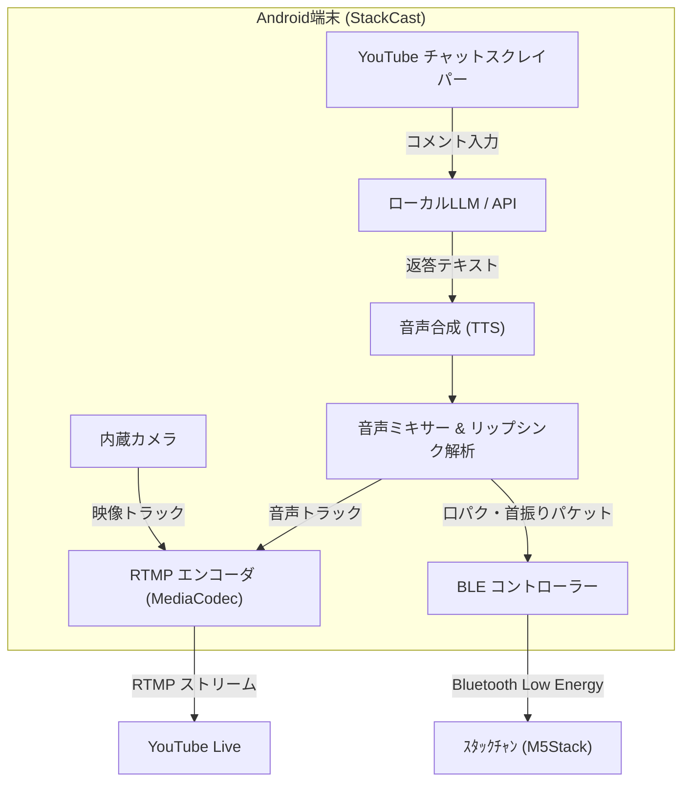

# StackCast (すたっくキャスト)

> **1台のAndroidスマートフォンで完結する、ｽﾀｯｸﾁｬﾝのための24時間AIライブ配信ハブアプリ**

`StackCast` は、YouTube Live 向けの RTMP 配信、オンデバイス LLM のモデル管理、音声合成、そしてｽﾀｯｸﾁｬﾝ（M5Stack）との Bluetooth 連携をスマートフォン1台に集約したオールインワン・ストリーミングアプリケーションです。

---

## 🌟 主な特徴

- 🎥 **オールインワンRTMP配信**: スマホのカメラでｽﾀｯｸﾁｬﾝを撮影しつつ、生成されたAI音声を合成してYouTube Liveへ直接ストリーミング。
- 🧠 **オンデバイスLLM応答**:
  - MediaPipe LLM Inference を使ったローカルモデルの応答生成。
  - 設定画面から LLM モデルのダウンロードと差し替えができる。
- 💬 **クォータフリー・チャット取得（Phase 7 で追加予定）**: YouTube の内部 API（Innertube）直接通信により、API クォータ制限なしでリアルタイムにコメントを収集する構成を追加予定。
- 🗣️ **高品質音声合成 & リップシンク同期**:
  - Android TTS / 小型音声合成エンジンで音声を生成。
  - 発話タイミングと音量（ボリュームエンベロープ）を解析し、ｽﾀｯｸﾁｬﾝの口パク・首振りを完全同期。
- 📶 **Bluetooth (BLE) 制御**: Wi-Fiの複雑な設定なしで、ｽﾀｯｸﾁｬﾝとシームレスにペアリング＆モーション送信。
- 🔋 **長時間連続稼働を見据えた構成**: 自動再接続、スリープ防止（WakeLock）、サーマル監視の拡張に備えた設計。

---

## 🏗️ システムアーキテクチャ

---

## 📋 動作要件

| 項目 | 要件 |
| :--- | :--- |
| **OS** | Android 8.0 (API Level 26) 以上（Android 12+ 推奨） |
| **RAM** | 6GB以上（ローカルLLM動作時は8GB以上推奨） |
| **SoC** | Snapdragon 778G / 8 Gen 1 以上、Dimensity 8000 以上（オンデバイスAI利用時） |
| **ハードウェア** | ｽﾀｯｸﾁｬﾝ（M5Stack CoreS3 / Core2 / Basic + メタルギアサーボ換装推奨） |
| **通信** | Bluetooth 4.2+ (BLE), Wi-Fi (上り10Mbps以上の安定回線) |

---

## 🛠️ 技術スタック & 主要ライブラリ

- **Language / UI**: Kotlin 1.9+, Android View (XML Layouts, ViewBinding, View/Fragment), Material Components
- **Streaming (RTMP)**: [RootEncoder](https://github.com/pedroSG94/RootEncoder) (旧 rtmp-rtsp-stream-client-java)
- **Local AI**: [Google MediaPipe GenAI / LLM Inference API](https://developers.google.com/mediapipe/solutions/genai/llm_inference)
- **Network / Scraping**: OkHttp 4, Kotlinx Serialization
- **Bluetooth**: Android BLE API (BluetoothGatt)
- **Background**: Android Foreground Service + WorkManager

---

## 🚀 クイックスタート

### 1. ｽﾀｯｸﾁｬﾝ側の準備

1. ｽﾀｯｸﾁｬﾝに `firmware/` 配下の `StackChan-CoreS3` ファームウェア（PlatformIO）を書き込みます。
2. 電源を入れ、BLEアドバタイズ待機状態（LED点滅または画面表示）にします。

### 2. アプリのセットアップ

1. 本リポジトリをクローンし、Android Studioでビルド・実機インストールします。
2. アプリを起動し、必要な権限（カメラ、マイク、Bluetooth、バッテリー最適化除外）を許可します。
3. **設定画面**を開き、以下を入力します:
    - **LLMモデルファイルURL・HuggingFaceアクセストークン**: 詳細は「ローカルLLM設定」項目で後述
    - **RTMP URL**: `rtmp://a.rtmp.youtube.com/live2`
    - **ストリームキー**: YouTube Studioの「ライブ配信を開始」→「配信設定」に表示されるストリームキー
    - **AIプロンプト設定**: ｽﾀｯｸﾁｬﾝのキャラクター設定（ペルソナ）
    - **LLMモデルURL / トークン**: モデルをダウンロードするためのURLと認証情報
    - **BLE接続先**: ｽﾀｯｸﾁｬﾝのデバイス名または MAC アドレス
4. 「ｽﾀｯｸﾁｬﾝに接続」をタップし、BLEデバイス一覧から該当のｽﾀｯｸﾁｬﾝを選択。
5. 「配信開始」ボタンを押すと、ストリーミングと音声・BLE 連携がスタートします。

#### ローカルLLM設定

ローカルLLMを利用する場合、以下の設定が必要です:

- **LLMモデルファイルURL**: HuggingFaceなどから取得したモデルファイルのURLを指定します。
  1. [Gemma3-1B-IT モデルページ](https://huggingface.co/litert-community/Gemma3-1B-IT)にアクセスしてライセンスに同意します。
  2. アプリのモデルファイルURL欄に以下を入力します:
     `https://huggingface.co/litert-community/Gemma3-1B-IT/resolve/main/gemma3-1b-it-int4.task?download=true`
- **HuggingFaceアクセストークン**: HuggingFaceアカウントで取得したアクセストークンを指定します。（アカウント登録が必要です）
  1. HuggingFaceのウェブサイトにログインし、[アクセストークンページ](https://huggingface.co/settings/tokens/new?tokenType=read)から新しいトークンを作成します。
  2. 作成したトークンをアプリのHuggingFaceアクセストークン欄に入力します。

上記を対応後、アプリ内の`モデルをダウンロード`ボタンをタップしてモデルを取得します。

---

## ⚠️ 24時間運用のための注意点

- **熱対策**: スマホ背面に取り付けるペルチェ素子クーラーや冷却ファンの併用を強く推奨します。
- **バッテリー保護**: 長期連続運用の際は、バッテリーへの負荷を軽減するため「充電上限80%設定」や「ダイレクト給電対応端末」の使用をおすすめします。
- **サーボ保護**: コメント待機時は自動的にサーボのトルクを解除（detach）する省電力・長寿命モードがデフォルトで有効になっています。

---

## 📄 ライセンス

本プロジェクトは Apache License 2.0 のもとで公開されています。
