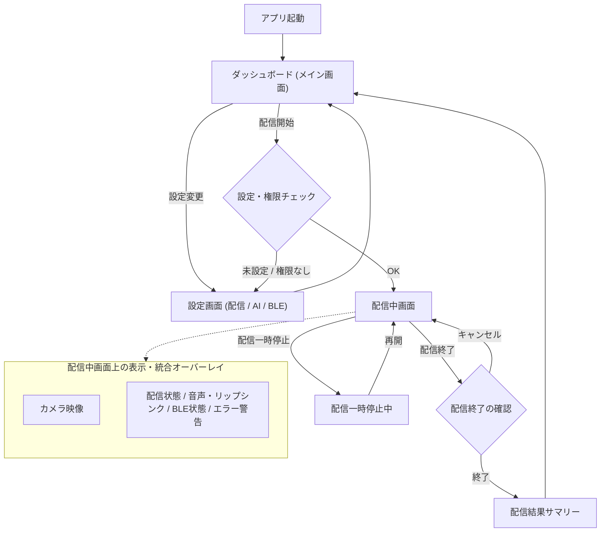

## 画面遷移

## 画面一覧

| 画面 | 役割 |
| --- | --- |
| アプリ起動 | 起動処理後、直接ダッシュボードへ遷移 |
| ダッシュボード | アプリの拠点。配信開始操作、各種ステータス確認、設定画面へのアクセスを行う |
| 設定画面 | 配信設定(RTMP/動画ID)、AI設定(LLM/ペルソナ)、BLE設定(ｽﾀｯｸﾁｬﾝ接続)をまとめて管理 |
| 配信中画面 | カメラプレビューとともに、配信状態・音声・リップシンク・BLE通信・エラー通知をオーバーレイ表示 |
| 配信結果サマリー | 配信終了時に配信時間や処理コメント数などの実績を表示 |
