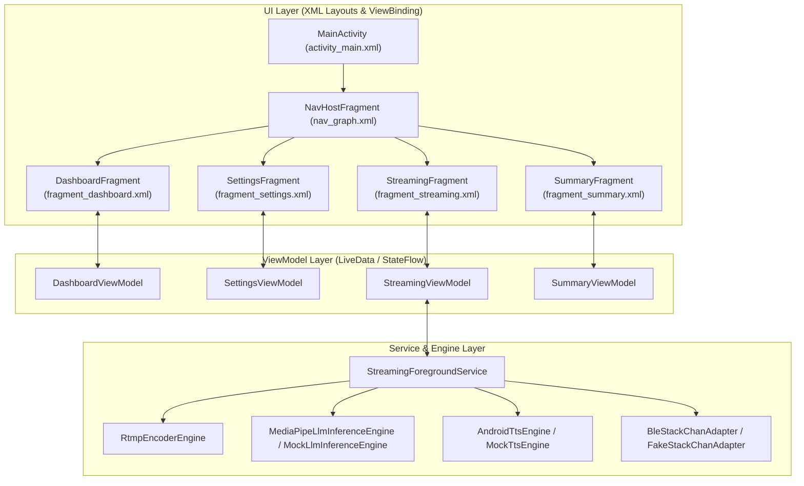

## アーキテクチャ概要

StackCast は従来型の Single Activity ＋ Fragment アーキテクチャ（`MainActivity` ＋ `FragmentContainerView` ＋ **Jetpack Navigation** ＋ **XMLレイアウト/ViewBinding**）を採用します。

24時間連続運用を支えるバックグラウンド処理は Android **Foreground Service** で管理します。

---

## Activity コンポーネント & レイアウト

### MainActivity & activity_main.xml

- **クラス**: `MainActivity`
- **レイアウト XML**: `activity_main.xml`
- **役割**: アプリの単一エントリーポイント。画面遷移用の `FragmentContainerView` の保持、アプリ全体の権限制御、画面常時オン (Keep Screen On) 設定。
- **XML 構成要素**:
  - `androidx.fragment.app.FragmentContainerView` (`@+id/nav_host_fragment`)
- **保持する処理**:
  - ViewBinding (`ActivityMainBinding`) の初期化
  - カメラ・マイク・Bluetooth・通知等の動的パーミッション要求・チェック
  - 画面スリープ防止 (`FLAG_KEEP_SCREEN_ON` / WakeLock) の設定
  - `StreamingForegroundService` へのバインド・接続管理

---

## Fragment (画面) コンポーネント & XMLレイアウト

### 1. DashboardFragment (ダッシュボード画面)

- **クラス**: `DashboardFragment`
- **レイアウト XML**: `fragment_dashboard.xml`
- **役割**: アプリ起動時に直接表示されるメイン画面。各種ステータスの概要確認と配信開始、設定画面へのナビゲーションを提供。
- **XML 構成要素**:
  - `MaterialCardView` (配信準備状態バッジ: RTMP設定、LLMモデル、接続機器)
  - `TextView` / `ProgressBar` (設定状態: 保存済み設定、モデルダウンロード状態、BLE接続状態)
  - `MaterialCardView` / `ImageView` (ｽﾀｯｸﾁｬﾝ BLE 接続ステータス)
  - `ExtendedFloatingActionButton` / `MaterialButton` (「配信開始」「設定」)
- **保持する処理**:
  - `FragmentDashboardBinding` による View 操作
  - 配信開始前の設定・権限プリフライトチェック実行
  - `LiveData` / `StateFlow` の観察によるリアルタイム設定・接続ステータス更新
  - Navigation Component による `SettingsFragment` / `StreamingFragment` への遷移

### 2. SettingsFragment (設定画面)

- **クラス**: `SettingsFragment`
- **レイアウト XML**: `fragment_settings.xml`
- **役割**: 配信・AI・BLE接続の全設定を統合管理する設定画面。
- **XML 構成要素**:
  - `ScrollView` / `NestedScrollView` 内の `MaterialCardView` グループ
  - **配信設定**: `TextInputLayout` + `TextInputEditText` (RTMP URL, ストリームキー, 解像度/FPS/ビットレート)
  - **AI設定**: `TextInputEditText` (システムプロンプト, キャラクター設定, LLMモデルURL, HuggingFaceトークン)
  - **BLE設定**: `RecyclerView` (BLEスキャン結果一覧), `MaterialButton` (スキャン開始/停止, 接続テスト)
  - **モデル管理**: `MaterialButton` (モデルダウンロード), `ProgressBar` (ダウンロード進捗)
  - `MaterialButton` (設定保存ボタン)
- **保持する処理**:
  - `FragmentSettingsBinding` による View 操作
  - 設定値の `DataStore` (Preferences) への保存・読み込み
  - BLEデバイススキャンおよび接続テストの起動
  - LLMモデルのダウンロード状態表示
  - 各入力値のバリデーションチェック

### 3. StreamingFragment (配信中画面)

- **クラス**: `StreamingFragment`
- **レイアウト XML**: `fragment_streaming.xml`
- **役割**: 全画面カメラプレビューの上に統合ステータスと操作コントロールをオーバーレイ表示する画面。
- **XML 構成要素**:
  - `OpenGlView` (`@+id/camera_preview`, 画面全体に配置)
  - `ConstraintLayout` (`@+id/overlay_container`, プレビュー上の全画面オーバーレイ)
    - **RTMPステータス**: `TextView` (ビットレート, FPS, 接続状態, 経過時間)
    - **音声・リップシンク**: `TextView` (最新発話テキスト), `TextView` (PCM/リップシンク状態)
    - **BLEステータス**: `TextView` / `ImageView` (通信状態, モーションコマンド)
    - **モデル/設定ステータス**: `TextView` (LLMモデルのロード状態, 設定保存状態)
  - `LinearLayout` (底面コントロールバー: カメラ切替、マイクミュート、配信終了ボタン)
- **保持する処理**:
  - `FragmentStreamingBinding` による View 操作
  - `OpenGlView` から `RtmpEncoderEngine` へのカメラフレーム供給
  - ViewBinding を通じたオーバーレイ表示の動的更新
  - `AlertDialog` を使った配信終了確認ダイアログの表示

### 4. SummaryFragment (配信結果サマリー画面)

- **クラス**: `SummaryFragment`
- **レイアウト XML**: `fragment_summary.xml`
- **役割**: 配信終了後に配信の実績を表示する画面。
- **XML 構成要素**:
  - `MaterialCardView` (配信時間、平均ビットレート、処理コメント数、AI応答回数)
  - `RecyclerView` / `TextView` (発生イベント・エラーログリスト)
  - `MaterialButton` (ダッシュボードへ戻るボタン)
- **保持する処理**:
  - `FragmentSummaryBinding` による View 操作
  - 配信実績データの表示
  - Navigation Component によるダッシュボードへの戻り遷移

---

## ViewModel コンポーネント

| ViewModel | 対応 Fragment | 保持する状態 (LiveData / StateFlow)・処理 |
| --- | --- | --- |
| `DashboardViewModel` | `DashboardFragment` | 端末状態データ、配信設定完了フラグ、画面遷移イベント |
| `SettingsViewModel` | `SettingsFragment` | `AppSettings`、BLEスキャン結果リスト、モデルダウンロード状態、保存・テスト処理 |
| `StreamingViewModel` | `StreamingFragment` | 配信ステータス、`StreamerEvent`、オーディオ・BLE更新イベント |
| `SummaryViewModel` | `SummaryFragment` | 配信サマリー集計データ、ログ表示データ |

---

## バックグラウンド & サービスコンポーネント

配信・設定・LLMモデル管理・BLE制御のため、以下の非UIコンポーネントを保持します。

### 1. StreamingForegroundService (フォアグラウンドサービス)

- **役割**: アプリがバックグラウンドに回っても配信・AI応答・BLE送信を継続させる中心サービス。
- **機能・処理**:
  - 常駐通知 (Notification) の表示とアップデート
  - 各種エンジンのライフサイクル管理（RTMP、LLM、TTS、BLE）
  - WakeLock（CPUスリープ防止）および WifiLock の保持

### 2. RtmpEncoderEngine (RTMP エンコーダエンジン)

- **役割**: カメラ映像と合成音声をエンコードし、YouTube Live へ RTMP ストリーミング送信する。
- **機能・処理**:
  - `RootEncoder` (MediaCodec) の初期化およびエンコード処理
  - ビットレート自動調整およびドロップフレーム検知

### 3. LlmInferenceEngine (AI 応答生成エンジン)

- **役割**: コメントに対する AI 返答テキストの生成。
- **機能・処理**:
  - MediaPipe LLM Inference (Gemma 3 系モデルなど) によるオンデバイス推論
  - モデルファイルのダウンロードと差し替え

### 4. TtsEngine (音声合成 & リップシンク解析)

- **役割**: 返答テキストの音声化および口パク・首振り同期データの解析。
- **機能・処理**:
  - Android TTS / 音声合成エンジンによる PCM データの生成
  - ボリュームエンベロープ解析による口パク開度・モーションデータの抽出

### 5. BleController (BLE コントローラー)

- **役割**: ｽﾀｯｸﾁｬﾝ (M5Stack) との Bluetooth Low Energy 通信。
- **機能・処理**:
  - BLE GATT 接続・切断・自動再接続
  - リップシンクデータおよびモーションパケットの低遅延送信
  - サーボ保護（待機時トルクオフ）パケットの送出

### 7. YouTubeChatScraperEngine (将来追加予定のチャット取得エンジン)

- **役割**: YouTube Innertube 直接通信によるリアルタイムコメント収集。
- **機能・処理**:
  - クォータフリーでのチャットポーリング処理
  - 取得コメントのキューイングと LLM への受渡

### 8. DeviceHealthMonitor (将来追加予定の端末ヘルス監視)

- **役割**: 端末バッテリー温度・負荷の監視と、長時間連続運用の保護。
- **機能・処理**:
  - サーマルレベル監視
  - ネットワーク切断時の自動再接続補助
  - 高温時のビットレート自動制限
