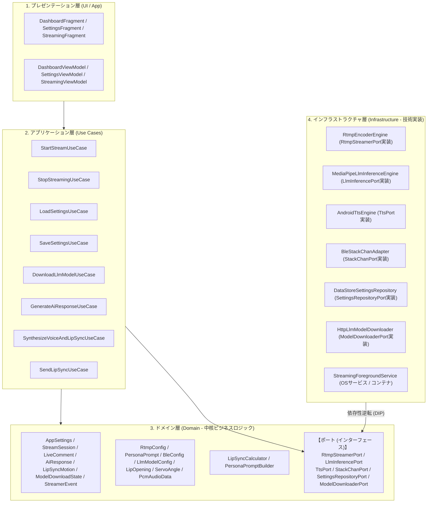
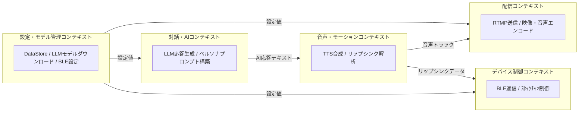

## アーキテクチャ方針

StackCast では、Android 固有のハードウェア依存処理（カメラ、BLE、RTMPエンコーダー、MediaPipe等）と、AIライブ配信における中核ロジック（リップシンク計算、ペルソナプロンプト構築、配信セッション状態管理等）を分離するため、**ドメイン駆動設計 (DDD) / オニオンアーキテクチャ** を採用します。



---

## 境界づけられたコンテキスト (Bounded Contexts)

  本システムは以下の 5 つの境界づけられたコンテキストに分割します。



1. **配信コンテキスト (Stream Context)**
   - 責務: カメラ映像と合成音声をRTMPストリームとしてYouTube Liveへ配信する。
  2. **設定・モデル管理コンテキスト (Settings & Model Context)**
    - 責務: 配信設定、ペルソナ設定、BLE設定、LLMモデルダウンロード設定の永続化と入力。
  3. **対話・AIコンテキスト (Chat & AI Context)**
    - 責務: ペルソナプロンプト適用と、LLM（オンデバイス）による応答テキスト生成。
  4. **音声・モーションコンテキスト (Audio & Motion Context)**
   - 責務: 返答テキストのTTS音声化、ボリュームエンベロープ解析による口パク開度・モーションデータの生成。
  5. **デバイス制御コンテキスト (Device Control Context)**
   - 責務: BLEによるｽﾀｯｸﾁｬﾝ（M5Stack）とのシームレス接続、モーションパケット送出、待機時サーボ省電力制御。

---

## ドメイン層のモデル定義

### 1. エンティティ (Entities)

- **`StreamSession`**
  - 配信セッションを表すルートエンティティ。配信状態（未開始 / 配信中 / 終了）、開始時刻、配信経過時間、エラー履歴を保持。
- **`AppSettings`**
  - 配信設定、ペルソナ設定、BLE設定、LLMモデル設定を束ねる設定集約ルート。
- **`LiveComment`**
  - 視聴者から受信したコメント。コメントID、投稿者名、本文、受信タイムスタンプ、処理状態（未処理 / 生成中 / 応答済み / スキップ）を保持。
- **`AiResponse`**
  - AIが生成した返答データ。対象コメントID、生成テキスト、使用モデル（Local / Cloud）、生成にかかった時間を保持。
- **`LipSyncMotion`**
  - ｽﾀｯｸﾁｬﾝへ送信する口パク・首振り動作フレーム。タイムオフセット、口の開度割合、サーボ傾き角度パケットを保持。
- **`ModelDownloadState`**
  - LLM モデルダウンロードの進捗・完了・失敗状態を表すシールドクラス。
- **`StreamerEvent`**
  - RTMP 配信の接続開始・成功・失敗・切断・ビットレート更新を表すイベント。

### 2. 値オブジェクト (Value Objects)

- **`RtmpConfig`**: RTMP URL、ストリームキー、解像度、フレームレート、ビットレート（不変オブジェクト）。
- **`PersonaPrompt`**: システムプロンプト、キャラクター設定、語尾ルール、NGワードリスト。
- **`BleConfig`**: ｽﾀｯｸﾁｬﾝの BLE MAC アドレス、表示名、自動再接続設定。
- **`LlmModelConfig`**: モデルダウンロード URL と HuggingFace トークン。
- **`LipOpening`**: 口の開度を表す値オブジェクト (0.0 〜 1.0)。
- **`ServoAngle`**: ｽﾀｯｸﾁｬﾝの首振り角度 (Pitch / Yaw)。安全制限角度を超えないバリデーションを内包。
- **`PcmAudioData`**: 16-bit PCM のサンプル列とサンプリングレートを保持する音声データ。

### 3. ドメインサービス (Domain Services)

- **`LipSyncCalculator`**
  - TTS音声の PCM 波形データ（ボリュームエンベロープ）を入力とし、一定時間刻みの `LipOpening` および感情・発話に応じた `ServoAngle` の系列（`LipSyncMotion`）を算出する。
- **`PersonaPromptBuilder`**
  - `LiveComment` と配信文脈（直前の会話履歴）、`PersonaPrompt` を組み合わせ、LLMに投入する最適な入力プロンプトを構築する。

---

## ポート (Ports / インターフェース) 定義

ドメイン層・アプリケーション層がインフラ技術に直接依存しないよう、以下のポート（インターフェース）をドメイン層に定義します。

```kotlin
// 配信ポート
interface RtmpStreamerPort {
  val events: SharedFlow<StreamerEvent>
  fun isReady(): Boolean
    fun isStreaming(): Boolean
  fun startPreview(): Result<Unit>
  fun stopPreview(): Result<Unit>
  suspend fun startStream(session: StreamSession): Result<Unit>
  suspend fun stopStream(): Result<Unit>
  fun release()
}

// LLM推論ポート
interface LlmInferencePort {
    suspend fun generateResponse(prompt: String): Result<String>
}

// TTSポート
interface TtsPort {
  suspend fun synthesizeToPcm(text: String): Result<PcmAudioData>
  suspend fun speak(text: String): Result<Unit>
  fun isReady(): Boolean
}

// ｽﾀｯｸﾁｬﾝ (BLE) 制御ポート
interface StackChanPort {
  val connectionState: StateFlow<StackChanConnectionState>
  fun isConnected(): Boolean
  suspend fun connect(deviceAddress: String): Result<Unit>
  suspend fun disconnect(): Result<Unit>
  suspend fun sendLipSyncMotion(motion: List<LipSyncMotion>): Result<Unit>
  suspend fun sendExpression(expression: AvatarExpression): Result<Unit>
}

// 設定永続化ポート
interface SettingsRepositoryPort {
  fun observeSettings(): Flow<AppSettings>
  suspend fun saveSettings(settings: AppSettings)
}

// モデルダウンロードポート
interface ModelDownloaderPort {
  fun download(config: LlmModelConfig, destinationPath: String): Flow<ModelDownloadState>
}
```

---

## アプリケーション層 (Use Cases)

ユースケースはドメインモデルと各ポートを組み合わせ、ユーザーの操作やバックグラウンドイベントに対する処理シナリオを表現します。

### 1. `StartStreamUseCase`

- **処理内容**:
  1. `RtmpConfig` の有効性を検証。
  2. `RtmpStreamerPort.startStream()` を実行。
  3. `StreamSession` を「配信中」に更新。

### 2. `SaveSettingsUseCase` / `LoadSettingsUseCase`

- **処理内容**:
  1. `SettingsRepositoryPort` を通じて `AppSettings` を保存・読み込みする。
  2. 設定画面のフォーム状態と DataStore の内容を同期する。

### 3. `DownloadLlmModelUseCase`

- **処理内容**:
  1. `ModelDownloaderPort.download()` を呼び出す。
  2. 進捗・完了・失敗を `ModelDownloadState` として UI に返す。

### 4. `GenerateAiResponseUseCase`

- **処理内容**:
  1. `PersonaPromptBuilder`（ドメインサービス）でプロンプトを生成。
  2. `LlmInferencePort.generateResponse()` を呼び出しテキストを取得する。

### 5. `SynthesizeVoiceAndLipSyncUseCase`

- **処理内容**:
  1. `TtsPort.synthesizeToPcm()` で PCM 音声データを取得する。
  2. `LipSyncCalculator`（ドメインサービス）で音声波形から `LipSyncMotion` を算出する。

### 6. `SendLipSyncUseCase`

- **処理内容**:
  1. `StackChanPort.sendLipSyncMotion()` で BLE パケットをｽﾀｯｸﾁｬﾝへ送信する。
  2. 必要に応じて `StackChanPort.sendExpression()` で表情も更新する。

---

## インフラストラクチャ層 (Infrastructure) の対応実装

ドメイン層で定義したポート（インターフェース）を、具象クラスとして実装します。

| ドメイン層ポート (Port) | インフラ層実装クラス (Adapter) | 使用技術 / ライブラリ |
| --- | --- | --- |
| `RtmpStreamerPort` | `RtmpEncoderEngine` / `MockRtmpEncoderEngine` | RootEncoder (MediaCodec, OpenGL) |
| `LlmInferencePort` | `MediaPipeLlmInferenceEngine` / `MockLlmInferenceEngine` | Google MediaPipe GenAI |
| `TtsPort` | `AndroidTtsEngine` / `MockTtsEngine` | Android TextToSpeech API |
| `StackChanPort` | `BleStackChanAdapter` / `FakeStackChanAdapter` | Android BluetoothGatt (BLE) |
| `SettingsRepositoryPort` | `DataStoreSettingsRepository` | Jetpack DataStore |
| `ModelDownloaderPort` | `HttpLlmModelDownloader` | OkHttp 4 / File I/O |

※ **`StreamingForegroundService`** は、これらのインフラ構成要素とユースケースをバックグラウンドで保持・実行するコンテナとして機能します。

---

## 将来拡張の候補

現行実装ではまだ有効化していないが、Phase 7 / Phase 8 で追加を想定している要素を以下に残します。

### 1. `YouTubeChatScraperEngine`

- **役割**: YouTube Innertube 直接通信によるリアルタイムコメント収集。
- **機能・処理**:
  - クォータフリーでのチャットポーリング処理
  - 取得コメントのキューイングと LLM への受渡

### 2. `DeviceHealthPort` / `AndroidDeviceHealthMonitor`

- **役割**: 端末バッテリー温度、CPU負荷、ネットワーク状態の監視。
- **機能・処理**:
  - サーマルレベルの監視
  - 自動再接続・送信抑制のトリガー
  - 高温時のビットレート制御
