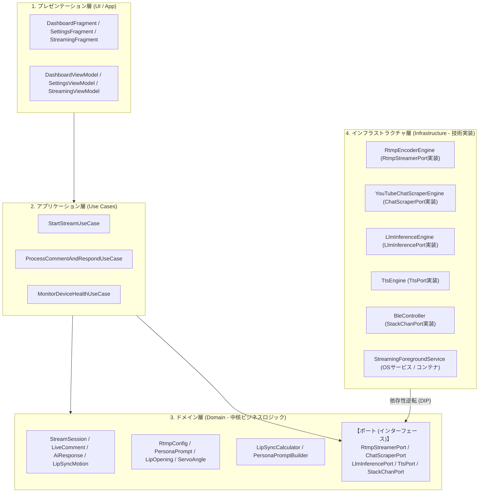
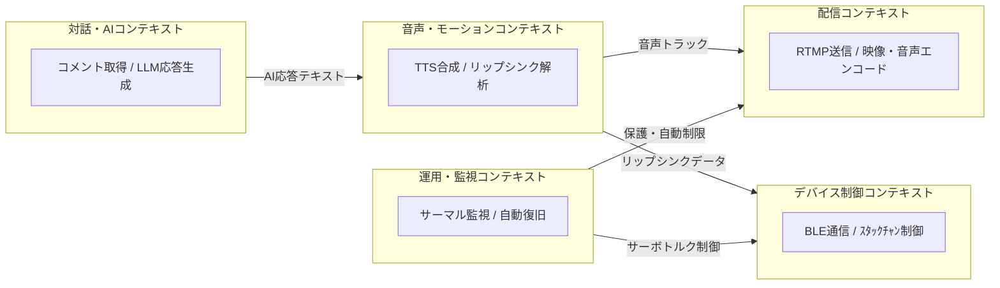

## アーキテクチャ方針

StackCast では、Android 固有のハードウェア依存処理（カメラ、BLE、RTMPエンコーダー、MediaPipe等）と、AIライブ配信における中核ロジック（リップシンク計算、ペルソナプロンプト構築、配信セッション状態管理等）を分離するため、**ドメイン駆動設計 (DDD) / オニオンアーキテクチャ** を採用します。



---

## 境界づけられたコンテキスト (Bounded Contexts)

本システムは以下の 5 つの境界づけられたコンテキストに分割します。



1. **配信コンテキスト (Stream Context)**
   - 責務: カメラ映像と合成音声をRTMPストリームとしてYouTube Liveへ配信する。
2. **対話・AIコンテキスト (Chat & AI Context)**
   - 責務: コメントの取得、ペルソナプロンプト適用、LLM（オンデバイス/クラウド）による応答テキスト生成。
3. **音声・モーションコンテキスト (Audio & Motion Context)**
   - 責務: 返答テキストのTTS音声化、ボリュームエンベロープ解析による口パク開度・モーションデータの生成。
4. **デバイス制御コンテキスト (Device Control Context)**
   - 責務: BLEによるｽﾀｯｸﾁｬﾝ（M5Stack）とのシームレス接続、モーションパケット送出、待機時サーボ省電力制御。
5. **運用・監視コンテキスト (Health & Monitoring Context)**
   - 責務: 端末バッテリー温度・負荷の監視、ネットワーク切断時の自動再接続、24時間連続運用ガード。

---

## ドメイン層のモデル定義

### 1. エンティティ (Entities)

- **`StreamSession`**
  - 配信セッションを表すルートエンティティ。配信状態（未開始 / 配信中 / 一時停止 / 終了）、開始時刻、配信経過時間、エラー履歴を保持。
- **`LiveComment`**
  - 視聴者から受信したコメント。コメントID、投稿者名、本文、受信タイムスタンプ、処理状態（未処理 / 生成中 / 応答済み / スキップ）を保持。
- **`AiResponse`**
  - AIが生成した返答データ。対象コメントID、生成テキスト、使用モデル（Local / Cloud）、生成にかかった時間を保持。
- **`LipSyncMotion`**
  - ｽﾀｯｸﾁｬﾝへ送信する口パク・首振り動作フレーム。タイムオフセット、口の開度割合、サーボ傾き角度パケットを保持。

### 2. 値オブジェクト (Value Objects)

- **`RtmpConfig`**: RTMP URL、ストリームキー、解像度、フレームレート、ビットレート（不変オブジェクト）。
- **`PersonaPrompt`**: システムプロンプト、キャラクター設定、語尾ルール、NGワードリスト。
- **`LipOpening`**: 口の開度を表す値オブジェクト (0.0 〜 1.0)。
- **`ServoAngle`**: ｽﾀｯｸﾁｬﾝの首振り角度 (Pitch / Yaw)。安全制限角度を超えないバリデーションを内包。
- **`DeviceHealthStatus`**: バッテリー温度、バッテリー残量、CPU使用率、ネットワーク下り/上り速度、サーマルレベル (Normal / Warning / Critical)。

### 3. ドメインサービス (Domain Services)

- **`LipSyncCalculator`**
  - TTS音声の PCM 波形データ（ボリュームエンベロープ）を入力とし、一定時間刻みの `LipOpening` および感情・発話に応じた `ServoAngle` の系列（`LipSyncMotion`）を算出する。
- **`PersonaPromptBuilder`**
  - `LiveComment` と配信文脈（直前の会話履歴）、`PersonaPrompt` を組み合わせ、LLMに投入する最適な入力プロンプトを構築する。

---

## ポート (Ports / インターフェース) 定義

ドメイン層・アプリケーション層がインフラ技術に直接依存しないよう、以下のポート（インターフェース）をドメイン層に定義します。

```kotlin
// 配信ポート
interface RtmpStreamerPort {
    fun startStream(config: RtmpConfig): Result<Unit>
    fun stopStream()
    fun isStreaming(): Boolean
    fun getStreamStats(): StreamStats
}

// チャット取得ポート
interface ChatScraperPort {
    fun startPolling(videoId: String, onCommentReceived: (LiveComment) -> Unit)
    fun stopPolling()
}

// LLM推論ポート
interface LlmInferencePort {
    suspend fun generateResponse(prompt: String): Result<String>
}

// TTSポート
interface TtsPort {
    suspend fun synthesizeSpeech(text: String): Result<AudioWaveData>
}

// ｽﾀｯｸﾁｬﾝ (BLE) 制御ポート
interface StackChanPort {
    fun connect(deviceAddress: String): Result<Unit>
    fun sendMotion(motion: LipSyncMotion)
    fun setServoTorque(enabled: Boolean)
    fun disconnect()
}

// 端末ヘルス監視ポート
interface DeviceHealthPort {
    fun getHealthStatus(): DeviceHealthStatus
}
```

---

## アプリケーション層 (Use Cases)

ユースケースはドメインモデルと各ポートを組み合わせ、ユーザーの操作やバックグラウンドイベントに対する処理シナリオを表現します。

### 1. `StartStreamUseCase`

- **処理内容**:
  1. `DeviceHealthPort` で端末状態を確認（バッテリー温度が高すぎないか等）。
  2. `RtmpConfig` の有効性を検証。
  3. `RtmpStreamerPort.startStream()` を実行。
  4. `ChatScraperPort.startPolling()` を開始。
  5. `StreamSession` を「配信中」に更新。

### 2. `ProcessCommentAndRespondUseCase`

- **処理内容**:
  1. `ChatScraperPort` から新しい `LiveComment` を受信。
  2. `PersonaPromptBuilder`（ドメインサービス）でプロンプトを生成。
  3. `LlmInferencePort.generateResponse()` を呼び出しテキストを取得（`AiResponse` 作成）。
  4. `TtsPort.synthesizeSpeech()` で音声波形データ（PCM）を合成。
  5. `LipSyncCalculator`（ドメインサービス）で音声波形から `LipSyncMotion` を算出。
  6. `StackChanPort.sendMotion()` で BLE パケットをｽﾀｯｸﾁｬﾝへ送信。
  7. 音声トラックを `RtmpStreamerPort` の音声ミキサーへ供給。

### 3. `MonitorDeviceHealthUseCase`

- **処理内容**:
  1. 定期的に `DeviceHealthPort.getHealthStatus()` を取得。
  2. サーマルレベルが Critical の場合、ビットレートを自動降下させるよう `RtmpStreamerPort` に通知。
  3. コメント待機時間が一定以上続いた場合、`StackChanPort.setServoTorque(false)` を呼び出してサーボを省電力・保護モードに移行。

---

## インフラストラクチャ層 (Infrastructure) の対応実装

ドメイン層で定義したポート（インターフェース）を、具象クラスとして実装します。

| ドメイン層ポート (Port) | インフラ層実装クラス (Adapter) | 使用技術 / ライブラリ |
| --- | --- | --- |
| `RtmpStreamerPort` | `RtmpEncoderEngine` | RootEncoder (MediaCodec, OpenGL) |
| `ChatScraperPort` | `YouTubeChatScraperEngine` | OkHttp 4, Innertube ポーリング |
| `LlmInferencePort` | `LlmInferenceEngine` | Google MediaPipe GenAI / OpenAI API |
| `TtsPort` | `TtsEngine` | Android TextToSpeech API |
| `StackChanPort` | `BleController` | Android BluetoothGatt (BLE) |
| `DeviceHealthPort` | `AndroidDeviceHealthMonitor` | BroadcastReceiver (`ACTION_BATTERY_CHANGED`) |

※ **`StreamingForegroundService`** は、これらのインフラ構成要素とユースケースをバックグラウンドで保持・実行するコンテナとして機能します。
