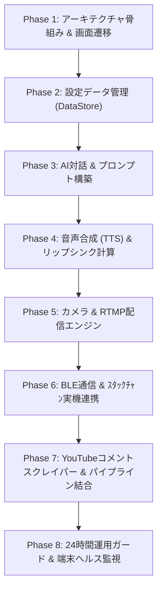

# 実装フェーズガイド

## 💡 実装進め方の方針

AI に実装を依頼する際、一括でコードを生成させると依存関係の崩れやデバッグ困難が生じやすくなります。そのため、**「1フェーズごとに必ずビルド・動作確認（画面表示または単体テスト）が成功すること」** を条件とした **8つの段階的フェーズ** に分けて実装を進めます。

### 3つの開発原則

1. **Fake/Mock アダプターの活用（ｽﾀｯｸﾁｬﾝ後回し）**
   - ｽﾀｯｸﾁｬﾝ（M5Stack）本体やBLE通信が未準備でも開発を止めないよう、最初はログ出力や画面上のダミーアニメーションを行う **`FakeStackChanAdapter`** を使用します。BLE制御は最終フェーズに回します。
2. **ドメイン層の単体テスト (Unit Test) 先行**
   - リップシンク解析やプロンプト生成などの核となるビジネスロジックは、Android に依存しない純粋 Kotlin のドメイン層として先に実装し、JUnit で単体テストを通してから画面やサービスに繋ぎます。
3. **フェーズごとの動く成果物の確認**
   - 各フェーズ完了時に「画面遷移ができる」「設定が保存できる」「カメラが映る」などの目に見える動作確認を行います。

---

## 🗺️ 全8フェーズの全体像



---

## 📋 各フェーズの詳細仕様

### Phase 1: アーキテクチャ骨組み & 画面遷移スキャフォールディング

- **目的**: プロジェクト全体のDDDパッケージ構造、Single Activity ＋ Navigation、ダミーUIの構築。
- **実装内容**:
  - `com.pandapan.stackcast` 配下の 4層パッケージ構造 (`presentation`, `application`, `domain`, `infrastructure`) の作成。
  - `MainActivity` (`activity_main.xml`), `NavHostFragment` (`nav_graph.xml`) のセットアップ。
  - 4つの Fragment (`Dashboard`, `Settings`, `Streaming`, `Summary`) とそれぞれの XML レイアウトおよび ViewBinding 設定。
  - ボタンタップによる相互画面遷移の疎通確認。
- **完了条件**: アプリを起動し、ダッシュボードから各画面へ遷移・戻りが正しく動作すること。

---

## 📝 AI指示用プロンプト例

### Phase 1 実装プロンプト例

AI (Copilot / Cursor / Subagent) に Phase 1 の実装を依頼する際は、以下のテキストをコピー＆ペーストしてご利用ください。

```markdown
# Phase 1 実装依頼: アーキテクチャ骨組み & 画面遷移スキャフォールディング

## 概要
`StackCast` プロジェクトの Phase 1 として、DDD（ドメイン駆動設計）に基づくパッケージ構造の作成、Single Activity + Fragment Navigation のセットアップ、および全4画面のダミーUIと画面遷移ロジックを実装してください。

## 前提条件・制約事項
- **UIフレームワーク**: Jetpack Compose は**使用不可**。Classic Android View System (Single Activity + Fragment + XML Layouts + ViewBinding) を使用すること。
- **パッケージ名**: `com.pandapan.stackcast`
- **コメント規約**: 作成・編集する全クラス・関数・プロパティに KDoc (`/** ... */`) を付与し、**すべてのコメントは日本語で記載**すること。

## 作業手順・指定ファイル

### 1. DDDパッケージ構造の作成
以下のパッケージディレクトリ構造を作成してください：
- `com.pandapan.stackcast.presentation.dashboard`
- `com.pandapan.stackcast.presentation.settings`
- `com.pandapan.stackcast.presentation.streaming`
- `com.pandapan.stackcast.presentation.summary`
- `com.pandapan.stackcast.application`
- `com.pandapan.stackcast.domain.model`
- `com.pandapan.stackcast.domain.ports`
- `com.pandapan.stackcast.infrastructure`

### 2. レイアウトXMLおよび ViewBinding の設定
以下のレイアウトを作成し、`ViewBinding` が有効になるよう構成してください：
- `res/layout/activity_main.xml`: `FragmentContainerView` (`@+id/nav_host_fragment`) を配置
- `res/layout/fragment_dashboard.xml`: タイトル、配信開始ボタン (`btn_start_stream`)、設定ボタン (`btn_settings`)
- `res/layout/fragment_settings.xml`: タイトル、戻るボタン (`btn_back`)
- `res/layout/fragment_streaming.xml`: タイトル、カメラプレビュー枠、配信終了ボタン (`btn_stop_stream`)
- `res/layout/fragment_summary.xml`: タイトル、ダッシュボードへ戻るボタン (`btn_back_to_dashboard`)

### 3. Navigation Graph の定義
`res/navigation/nav_graph.xml` を作成し、`DashboardFragment` をスタート地点として以下の画面遷移アクションを定義してください：
- `action_dashboard_to_settings`: Dashboard -> Settings
- `action_dashboard_to_streaming`: Dashboard -> Streaming
- `action_streaming_to_summary`: Streaming -> Summary
- `action_summary_to_dashboard`: Summary -> Dashboard (PopUpTo Dashboard)

### 4. Activity & Fragment クラスの実装
- `MainActivity.kt`: `activity_main.xml` をセットアップし、スリープ防止 (`FLAG_KEEP_SCREEN_ON`) を設定。
- `DashboardFragment.kt`: ボタンタップで `SettingsFragment` または `StreamingFragment` へ遷移。
- `SettingsFragment.kt`: ボタンタップまたはシステムバックで `DashboardFragment` へ戻る。
- `StreamingFragment.kt`: ボタンタップで `SummaryFragment` へ遷移。
- `SummaryFragment.kt`: ボタンタップで `DashboardFragment` へ戻る。

## 完了確認
- プロジェクトがビルドエラーなしでコンパイルできること。
- アプリを起動すると直接ダッシュボード画面が表示され、各ボタンタップで相互に画面遷移できること。
```

---

### Phase 2: 設定データ管理 (DataStore & Repository)

- **目的**: 配信設定、AI設定、BLE設定の永続化と設定画面の完成。
- **実装内容**:
  - ドメイン層: 値オブジェクト (`RtmpConfig`, `PersonaPrompt`, `BleConfig`) と `SettingsRepositoryPort` インターフェース。
  - インフラ層: Jetpack DataStore (Preferences) による `DataStoreSettingsRepository` の実装。
  - プレゼンテーション層: `SettingsViewModel` と `SettingsFragment` (XMLフォーム) の双方向バインディング。
  - 単体テスト: DataStore への設定値保存・読み込みのテスト。
- **完了条件**: 設定画面で入力した値（RTMP URLやプロンプト）がアプリ再起動後も保持されること。

---

### Phase 3: AI対話ロジック & LLM推論エンジン

- **目的**: コメントに対する AI 応答テキスト生成パイプラインの構築。
- **実装内容**:
  - ドメイン層: エンティティ (`LiveComment`, `AiResponse`), ドメインサービス (`PersonaPromptBuilder`), `LlmInferencePort` インターフェース。
  - 単体テスト: `PersonaPromptBuilder` の各種キャラクター設定・語尾付与のテスト。
  - インフラ層: `LlmInferenceEngine`（MediaPipe GenAI LLM Inference API 実装および動作テスト用 `MockLlmInferenceEngine`）。
  - ユースケース層: `GenerateAiResponseUseCase` の作成。
- **完了条件**: 擬似コメント文字列を渡すと、設定したペルソナプロンプトに従ったAI返答テキストが取得できること。

---

### Phase 3 実装プロンプト例

AI (Copilot / Cursor / Subagent) に Phase 3 の実装を依頼する際は、以下のテキストをコピー＆ペーストしてご利用ください。

````markdown
# Phase 3 実装依頼: AI対話ロジック & オンデバイス LLM 推論エンジン (MediaPipe GenAI)

## 概要
`StackCast` プロジェクトの Phase 3 として、コメントに対する AI 返答テキストの生成パイプライン（ドメインモデル、プロンプト構築サービス、MediaPipe GenAI LLM Inference API を用いたローカルLLM推論エンジン、ユースケース、単体テスト）を実装してください。

## 前提条件・制約事項
- **LLMライブラリ**: オンデバイス推論エンジンには MediaPipe GenAI LLM Inference API (`com.google.mediapipe:tasks-genai`) を使用すること。モデル未配置時や単体テスト用に動作するモック実装（`MockLlmInferenceEngine`）も用意すること。
- **純粋Kotlinドメイン**: ドメイン層 (`domain/`) は Android SDK (`android.*`) に依存させず、純粋な Kotlin コードとすること。
- **コメント規約**: 作成・編集する全クラス・関数・プロパティに KDoc (`/** ... */`) を付与し、**すべてのコメントは日本語で記載**すること。

## 作業手順・指定ファイル

### 1. ドメインモデル & ポートの定義 (`domain/`)
- `domain/model/LiveComment.kt`: 受信コメントを表すデータクラス (id, author, text, timestamp)。
- `domain/model/AiResponse.kt`: AI返答を表すデータクラス (commentId, responseText, modelName, executionTimeMs)。
- `domain/model/PersonaPrompt.kt`: キャラクター設定 (systemPrompt, characterName, toneEnding, ngWords)。
- `domain/ports/LlmInferencePort.kt`: LLM推論インターフェース。
  ```kotlin
  interface LlmInferencePort {
      suspend fun generateResponse(prompt: String): Result<String>
      fun isModelLoaded(): Boolean
  }
  ```

### 2. ドメインサービスの実装 (`domain/services/`)
- `PersonaPromptBuilder.kt`: `PersonaPrompt` と `LiveComment` および直前の会話履歴を組み合わせて、LLMへ投入する最適な単一テキストプロンプトを構築する純粋Kotlinサービス。
  - キャラクターの語尾（「〜のだ」「〜です」など）や口調ルールを適用する処理を含む。

### 3. ドメイン層の単体テスト作成 (`test/`)
- `PersonaPromptBuilderTest.kt`: JUnit 4 / 5 を使用し、`PersonaPromptBuilder` がプロンプト文字列や語尾調整を正しく行うことを検証する単体テスト。

### 4. インフラ層の実装 (`infrastructure/llm/`)
- `MediaPipeLlmInferenceEngine.kt`: `LlmInferencePort` を実装。MediaPipe GenAI LLM Inference API (`LlmInference`) を用いたローカルモデル (.bin / .task) の読み込み・応答生成処理。
- `MockLlmInferenceEngine.kt`: 単体テストやモデルファイル未配置時に動作するダミーエンジン。指定されたプロンプトに対して即座に擬似返答を返す。

### 5. アプリケーション層 (ユースケース) の実装 (`application/`)
- `GenerateAiResponseUseCase.kt`: `PersonaPromptBuilder` と `LlmInferencePort` を呼び出し、`LiveComment` から `AiResponse` を生成して返却するユースケース。

## 完了確認
- `PersonaPromptBuilderTest` の単体テストを実行し、テストがすべて成功すること。
- モックまたは MediaPipe エンジン経由で `GenerateAiResponseUseCase` を呼び出し、キャラクターのペルソナが反映された `AiResponse` が取得できること。
````

---

### Phase 4: 音声合成 (TTS) & リップシンク波形解析

- **目的**: 返答テキストからの音声生成と、音量エンベロープによる口パク・首振りパケットの算出。
- **実装内容**:
  - ドメイン層: 値オブジェクト (`LipOpening`, `ServoAngle`), エンティティ (`LipSyncMotion`), ドメインサービス (`LipSyncCalculator`), `TtsPort` インターフェース。
  - 単体テスト: PCM 音声波形（バイト配列）から正しい口の開度 (0.0〜1.0) と角度が算出できるかのテスト。
  - インフラ層: `AndroidTtsEngine`（Android TextToSpeech API）。
  - ユースケース層: `SynthesizeVoiceAndLipSyncUseCase` の作成。
- **完了条件**: テキストを入力すると Android から音声が再生され、ログまたはUI上に口パク開度データの時系列が正しく生成されること。

### StackChan へのモーション送信（Phase4 拡張 — 推奨）

- **意図**: 実機の `StackChan` に物理的に「喋らせる」よりも、まずは **Android 側で音声を再生し、その音声に同期する口パク・首振りの時系列（`LipSyncMotion`）を BLE で送る** アプローチをお勧めします。これにより Android の PCM キャプチャの複雑さを回避し、BLE帯域で送れる軽量なモーション命令のみを扱うことで実装とデバッグが大幅に簡単になります。

- 実装作業例（追加）:
  - `domain/ports/StackChanPort.kt` を定義（`sendLipSyncMotion(motion: LipSyncMotion): Result<Unit>` など）
  - `infrastructure/ble/BleStackChanAdapter.kt` を実装（`StackChanPort` の BLE 実装。ペアリング、接続管理、パケット送信）
  - `domain/model/LipSyncMotion.kt` を確定し、送信フォーマットを設計する
  - `application/SendLipSyncUseCase.kt`（`SynthesizeVoiceAndLipSyncUseCase` の出力を `StackChanPort` に送る責務）を追加

- `LipSyncMotion` パケット仕様（参考・可変）:
  - ヘッダ: `uint8_t version` (1 byte)
  - シーケンス番号: `uint16_t seq` (2 bytes)
  - サンプル数: `uint8_t count` (1 byte) — このパケットに含む時系列点の数
  - 各サンプル (固定長エントリ):
    - `uint32_t timestampMs` (4 bytes) — イベント時刻（UNIX ms または相対 ms）
    - `uint8_t lip` (1 byte) — LipOpening を 0..255 のスケールで量子化
    - `int16_t servoAngle` (2 bytes) — 角度を 0.01deg 単位などでスケールして整数化
  - CRC / チェックサム（任意）: 2 bytes

  合計サイズの例: ヘッダ(4) + sample*N*(7) + checksum(2) という形で BLE の MTU を意識して `count` を調整します。

- 送信設計のポイント:
  - タイムスタンプは受信側のクロック補正を前提にするか、簡易的には "送信からのオフセットで再生" する方式を取る（受信遅延や再送を考慮）
  - パケットは小さくまとめ、必要なら複数パケットに分割して送る
  - 緊急停止/サーボ安全命令フレームを別IDで用意する

- 追加の完了条件（StackChan連携）:
  - `BleStackChanAdapter` 経由で `LipSyncMotion` パケットが実機またはFakeAdapterで受信できること
  - 受信側でモーション命令をパースし、口パク値とサーボ角度の再生テストができること

この追加により、Phase4 は「Android 側での音声合成＋LipSync計算」に集中しつつ、同時に `StackChan` への送信経路を早期に作って統合テストを行えるようになります。

---

### Phase 4 実装プロンプト例

AI (Copilot / Cursor / Subagent) に Phase 4 の実装を依頼する際は、以下のテキストをコピー＆ペーストしてご利用ください。

```markdown
# Phase 4 実装依頼: 音声合成 (TTS) とリップシンク波形解析

## 概要
`StackCast` プロジェクトの Phase 4 として、AI返答テキストを音声化し、再生音の音量エンベロープから口パク（LipOpening）とサーボ角（ServoAngle）を算出するパイプラインを実装してください。ドメイン駆動設計（DDD）に沿い、ドメインは純粋Kotlinでテスト可能にします。Android 実装はインフラ層で分離してください。

## 前提・制約
- UI: Classic Android View（XML + Fragment + ViewBinding）を継続使用すること。
- コメント規約: 全クラス/関数/プロパティに日本語のKDocを付与すること。
- リアルタイム要件: 目標レイテンシ 50–250ms（実装時に測定と調整を実施）。
- テスト: ドメインの `LipSyncCalculator` はユニットテストを必須とすること。

## 実装対象ファイル（例・命名は自由）
- domain/model/LipOpening.kt — 0.0〜1.0 の口の開度を表す値オブジェクト
- domain/model/ServoAngle.kt — サーボ角度を表す値オブジェクト
- domain/model/LipSyncMotion.kt — 時系列の (timestampMs, lipOpening, servoAngle) を表すエンティティ
- domain/ports/TtsPort.kt — TTS を抽象化するポート（例: `synthesizeToPcm(text): Result<PcmData>` / `speak(text): Result<Unit>` / `isReady(): Boolean`）
- domain/services/LipSyncCalculator.kt — PCM バイト列または FloatArray から時系列の LipOpening を算出する純粋Kotlinサービス
- application/SynthesizeVoiceAndLipSyncUseCase.kt — テキストから TTS -> PCM取得 -> LipSync計算 -> LipSyncMotion を返すユースケース
- infrastructure/tts/AndroidTtsEngine.kt — `TtsPort` 実装（Android TextToSpeech を使用、必要に応じて synthesizeToFile で生成して読み取り）
- infrastructure/tts/MockTtsEngine.kt — 単体テストとデバイス未準備時に使うダミー（合成は正弦波や合成PCMを返す）
- test/domain/LipSyncCalculatorTest.kt — 合成PCM（無音、単音、雑音混在）で `LipSyncCalculator` の出力が規定の閾値・平滑化動作を満たすか検証するテスト
- presentation/streaming/LipSyncOverlayView.kt（任意） — 計算結果をログまたはUIで可視化する簡易オーバーレイ（完了条件確認用）

## 実装要件・アルゴリズム仕様（必須）
- PCM 入力仕様: 16-bit PCM, サンプルレート 16kHz または 48kHz（設定可能にする）
- エンベロープ算出: 短時間窓（例: 10–40ms）で RMS または振幅絶対値ピークを計算し、ローパスフィルタ（移動平均や IIR）で平滑化する実装を提供すること
- 正規化とノイズ対策: 無音閾値、デシベルスケーリング、長時間無音での口閉じ（0.0）判定を行うこと
- マッピング: 正規化されたエンベロープを `LipOpening`（0.0–1.0）に線形または非線形（tanh, pow）マッピングする実装を用意し、`ServoAngle` への変換をパラメータ化すること
- スレッドモデル: 音声合成は別スレッド/コルーチンで実行し、LipSync計算はストリーミングバッファで逐次処理すること
- 出力: `LipSyncMotion` はタイムスタンプ付き時系列で返す。UI/ログ表示・FakeStackChanAdapter への送信は別責務とする

## テスト要件
- `LipSyncCalculatorTest` に以下ケースを含める:
  - 完全な無音（出力全0）
  - 単一周波数正弦波（開度が期待通り変化）
  - 短い発話フレーズ（立ち上がり/減衰の挙動）
  - ノイズ混入（SNR低下時のロバストネス）
- MockTtsEngine を使った統合テスト: テキスト -> MockTts（合成PCM） -> UseCase -> LipSyncMotion を実行し、時系列が生成されることを検証する

## 完了条件（受け入れ基準）
- `LipSyncCalculator` のユニットテストがすべて成功すること
- `MockTtsEngine` 経由で `SynthesizeVoiceAndLipSyncUseCase` を呼び出すと、ログまたはデバッグUI上にタイムスタンプ付きの `LipSyncMotion` が出力されること
- 実機（AndroidTtsEngine）でテキストを合成し、合成音から LipOpening の時系列が生成されること（最初は synthesizeToFile を使いファイルを解析して確認で良い）

---

**Phase 4 実装チェックリスト（コピペ用）**
- LipOpening / ServoAngle / LipSyncMotion のドメイン定義
- `TtsPort` と `LipSyncCalculator` の実装（ドメイン/インターフェース分離）
- `MockTtsEngine` と `AndroidTtsEngine` の作成
- `SynthesizeVoiceAndLipSyncUseCase` の実装とテスト
- `LipSyncCalculatorTest` の自動化
- 簡易オーバーレイで動作確認（ログ可視化でも可）

---

**懸念点・未考慮項目（優先順）**

- Android TTS の PCM 取得方法制約:
  - 標準の `TextToSpeech` は主に「再生する」ための API であり、再生時の生PCMバッファを直接アプリへ渡す機能は標準では提供されていません。現実的な代替手段は次のとおりです。
    1. `synthesizeToFile` で音声ファイル（例: WAV）を生成してファイルを読み取り解析する — 互換性は高いがファイルI/Oに伴う遅延がある。
    2. `AudioPlaybackCapture`（API 29+）で自アプリの再生ストリームをキャプチャしてPCMを取得する — 低レイテンシ寄与が期待できるが、APIレベル制約やキャプチャ許可・プライバシー設定の確認が必要。
    3. PCM コールバックを提供するサードパーティ／ネイティブの TTS ライブラリを導入する — 低遅延だが導入コストとライセンス・バイナリサイズを検討する必要がある。
  - 選択によりリアルタイム性、必要権限、端末互換性が変わるため、要件（目標遅延）に基づく評価が必要です。
- リアルタイム性とレイテンシ:
  - `synthesizeToFile` はファイル生成→読み取りの工程が入るため厳密なリアルタイム同期には向きません。現実的な進め方の例:
    - まずは `MockTtsEngine` と `synthesizeToFile` によるワークフローで `LipSyncCalculator` のアルゴリズムと閾値を確定する（互換性・テストの容易さ）。
    - 要件が満たせない場合、`AudioPlaybackCapture` の PoC を作り遅延を測定するか、PCM コールバックを備えた外部 TTS を評価して切り替える。
  - 実機での遅延・CPU負荷・音量差の実測と、それに基づくウィンドウサイズ／平滑化パラメータ調整が必須です。
- 標本化周波数・バッファサイズの決定:
  - サンプルレート変換やバッファサイズ不一致が発生する可能性。RTMP 音声ミキシングや他コンポーネントと合わせるための標準値（例48kHz）を決める必要あり。
- 音量正規化と発話検出の閾値:
  - 環境ノイズやTTSの音量差に対して閾値/ゲイン調整が必要。自動ゲイン補正や長期平均レベルをどう扱うかを設計する必要がある。
- CPU負荷と電力消費:
  - 高頻度の短時間RMS計算やサンプリングはCPU負荷を招く。実機での性能評価とバッファ/ウィンドウサイズ調整が必要。
- マルチトラック/ミキシング時の同期:
  - 他音声（マイク、BGM、配信ミックス）と同期する場合、どのタイミングでLipSyncを算出するか設計が必要（TTS再生先のミキサーから取得するのが理想）。
- サーボパラメータと安全性:
  - `ServoAngle` の範囲やトルク制御、急激な角度変化の制限（スムージング）を決める必要がある。ハードウェア保護ロジックは未実装。
- テストフィクスチャ準備:
  - 良質なテスト用PCM（複数サンプルレート、SNRバリエーション）を用意する必要がある。合成音ファイルのサンプルセットを用意推奨。
- 権利・ライセンス:
  - 使用する TTS エンジンや外部ライブラリのライセンスと商用利用可否を確認すること。
- Android 音量・オーディオフォーカス管理:
  - 再生中のオーディオフォーカス制御、音声ルーティング（Bluetooth）やユーザーミュートへの対応を実装する必要がある。
- エンドツーエンド統合の優先度:
  - Phase 3（LLM）でオンデバイスモデルを選定した場合、TTS との統合タイミング（同期方法、モデルサイズ、起動オーバーヘッド）を決める必要がある。

```

---

### Phase 5: カメラプレビュー & RTMP 配信エンジン

- **目的**: スマホカメラのプレビュー表示と RTMP 配信（映像/音声のエンコード → RTMP 送出）の単体動作を実装し、配信パイプラインの基礎を確立する。
- **実装内容（概要）**:
  - ドメイン層: `StreamSession`（配信設定）などのモデルと `RtmpStreamerPort` インターフェース。
  - インフラ層: `RtmpEncoderEngine`（`MediaCodec`/RootEncoder ラッパー）と `StreamingForegroundService` の骨組み。
  - プレゼンテーション層: `StreamingFragment`（`PreviewView`/`SurfaceView` 等）でのカメラプレビュー、配信開始/停止ボタン、配信ステータス表示。

---

```markdown
# Phase 5 実装依頼: カメラプレビュー & RTMP 配信エンジン

## 概要
`StackCast` の Phase 5 として、スマホカメラのプレビュー表示と RTMP 配信エンジン（映像/音声のエンコード + RTMP 送出）を実装してください。設計は既存の DDD 構成に沿い、プレゼンテーションは Fragment + XML、インフラは Foreground Service + エンコーダで分離します。

## 前提・制約
- UI: Classic Android View（XML + Fragment + ViewBinding）を使用すること。
- パッケージ: `com.pandapan.stackcast` 配下の既存構成を維持すること。
- コメント: すべての public/internal クラスに日本語の KDoc を付与すること。
- マニフェスト権限: `CAMERA`, `RECORD_AUDIO`, `INTERNET`, `FOREGROUND_SERVICE` を適切に設定し、ランタイム許可のハンドリングを実装すること。
- 推奨ライブラリ: CameraX（推奨）または Camera2、エンコードは `MediaCodec`（または RootEncoder のラッパー）を使用すること。

## 指定ファイル（推奨実装）
- `presentation/streaming/StreamingFragment.kt` — カメラプレビューと UI（`fragment_streaming.xml`）
- `presentation/streaming/StreamingViewModel.kt` — 状態管理（配信状態、エラー、ビットレート）
- `domain/model/StreamSession.kt` — `rtmpUrl`, `videoWidth`, `videoHeight`, `fps`, `videoBitrate`, `audioSampleRate` など
- `domain/ports/RtmpStreamerPort.kt` — `startStream(session: StreamSession): Result<Unit>` / `stopStream(): Result<Unit>` 等
- `infrastructure/rtmp/RtmpEncoderEngine.kt` — `RtmpStreamerPort` 実装（`MediaCodec` で H.264/AAC をエンコードし RTMP に送出）
- `infrastructure/service/StreamingForegroundService.kt` — フォアグラウンドサービスで配信のライフサイクル管理
- `infrastructure/camera/CameraXProvider.kt` — CameraX セットアップと `Preview` の提供
- `infrastructure/rtmp/MockRtmpEncoderEngine.kt` — テスト用モック（ネットワーク送出は行わずログ出力）
- `test/.../StreamingIntegrationTest.kt` — ViewModel + Mock エンコーダでの統合テスト

## 実装要件・設計指針
- プレビュー: `PreviewView`（CameraX）を用いた全画面プレビュー。ライフサイクルにバインドすること。
- エンコード: 映像は H.264（`MediaCodec`）、音声は AAC（`MediaCodec`/`AudioRecord`）でエンコードして RTMP に送出すること。
- フォアグラウンドサービス: 配信中は Notification を表示し `START_STICKY` を利用して維持すること。サービスはエンコーダの起動/停止を担当する。
- スレッドモデル: エンコード・ネットワーク処理は Kotlin Coroutines（`Dispatchers.IO`）で行い、UI は `Dispatchers.Main` を使用すること。
- 設定パラメータ: `StreamSession` によるビットレート・解像度・FPS・オーディオレートの可変化を必須とすること。
- 再接続戦略: ネットワーク断時の簡易リトライ（exponential backoff）を導入すること（最小限の安全策）。
- ロギング: ビットレート、エンコード遅延、送出エラー、キーフレーム間隔などをログ出力すること。

## テスト要件
- `MockRtmpEncoderEngine` を使って `StreamingViewModel` の状態遷移（`Idle`→`Starting`→`Streaming`→`Stopping`→`Idle`）をユニットテストで確認すること。
- 実機統合テスト: テスト RTMP サーバ（または YouTube テスト配信）へ映像が届くことを確認する（まずは開発環境でモックを通すこと）。

## 完了条件（受け入れ基準）
- `StreamingFragment` でカメラプレビューが表示されること。
- 「配信開始」押下で `RtmpEncoderEngine`（モックまたは実装）が起動し、`StreamingViewModel` が `Streaming` 状態になること。
- 実装版でテスト RTMP サーバに映像が届くこと（モック検証後に実装で確認）。
- ForegroundService により画面ロック後も配信が継続されること（OS制限内で検証）。

## 注意事項
- `MediaCodec` の初期化/解放ミスはリソースリークやクラッシュを招くため厳密に実装すること。
- 実機でのエンコード負荷・発熱評価を早期に行いパラメータを調整すること。
- YouTube へ配信する場合は配信キーの管理と利用規約に注意すること。
- Android 12+ の Foreground Service 制約、バックグラウンド制限に注意すること。

```

---

### Phase 6: BLE 通信 & ｽﾀｯｸﾁｬﾝ実機連携

- **目的**: ｽﾀｯｸﾁｬﾝ（M5Stack）との Bluetooth 接続およびリアルタイムモーション送信を最優先で実装し、実機連携を早期に確認する。
- **実装内容**:
  - ドメイン層: `StackChanPort` インターフェース。
  - インフラ層: Android `BluetoothGatt` を使用した `BleController` 実装（`FakeStackChanAdapter` を差し替える）。
  - ユースケース層: `SendLipSyncUseCase`（`LipSyncMotion` を `StackChanPort` に送信）。
  - プレゼンテーション層: `SettingsFragment` での BLE デバイススキャン・ペアリング UI と接続ステータス表示。
  - パケット送出: リップシンクパケット (`LipSyncMotion`) のバイナリシリアライズと低遅延送信、省電力トルクオフコマンドの送信。
- **完了条件**: 実機のｽﾀｯｸﾁｬﾝと BLE ペアリングでき、`LipSyncMotion` パケットを受信して口パク・首振り動作を確認できること。

---

### Phase 6 実装プロンプト例

AI (Copilot / Cursor / Subagent) に Phase 6 の実装を依頼する際は、以下のテキストをコピー＆ペーストしてご利用ください。

```markdown
# Phase 6 実装依頼: BLE 通信 & ｽﾀｯｸﾁｬﾝ実機連携

## 概要
`StackCast` プロジェクトの Phase 6 として、`StackChan`（M5Stack）との BLE ペアリング、接続管理、低遅延リップシンクモーションパケットの送信機能を実装してください。実機が手元にあるため、実機での接続検証とパケット送受信の確認が主目的です。

## 前提・制約
- **UI**: Classic Android View（XML + Fragment + ViewBinding）を使用すること。
- **パッケージ**: `com.pandapan.stackcast` 配下の既存構成を維持すること。
- **コメント**: すべての public/internal クラスに日本語の KDoc を付与すること。
- **BLE MTU/パフォーマンス**: MTU と接続レイテンシを考慮し、パケット分割・再送の設計を盛り込むこと。

## 指定ファイル（推奨）
- `domain/ports/StackChanPort.kt` — `sendLipSyncMotion(motion: LipSyncMotion): Result<Unit>` などを定義するポート。
- `domain/model/LipSyncMotion.kt` — 時系列の lip/servo 値を表すデータクラスとバイナリシリアライズユーティリティ。
- `infrastructure/ble/BleStackChanAdapter.kt` — `StackChanPort` の Android BLE 実装（スキャン・接続・MTUネゴシエーション・書き込み/通知のハンドリング）。
- `infrastructure/ble/FakeStackChanAdapter.kt` — ローカル開発用のモック（ログ出力 or ローカル内部動作シミュレーション）。
- `application/SendLipSyncUseCase.kt` — `LipSyncMotion` を受け取り `StackChanPort` に送信するユースケース。
- `presentation/settings/SettingsFragment.kt` の BLE UI 拡張 — デバイススキャン、接続ボタン、送信テストボタン。

## 実装要件・設計指針
- BLE スキャンと接続: `BluetoothLeScanner` と `BluetoothGatt` を用い、接続のライフサイクル（接続成功/切断/再接続）を正しく管理すること。
- MTU とパケット化: `LipSyncMotion` の時系列点を MTU に合わせて分割し、各パケットにシーケンス番号とタイムスタンプを付与すること。必要に応じて簡易 ACK/再送を実装する。
- 低遅延送信: 書き込みは `WRITE_WITHOUT_RESPONSE` を優先し、必要に応じてバッファリングと送信ウィンドウを設けること。
- 並列安全とエラーハンドリング: BLE 接続の例外・タイムアウトを取り扱い、UI にステータスを反映すること。
- テスト: 実機でのペアリング・接続確認、`FakeStackChanAdapter` を用いたユニットテストを用意すること。

## テスト手順（開発者向け）
1. `Settings` 画面でデバイススキャンを開始し、`StackChan` を選択して接続する。
2. 接続成功時に MTU サイズを確認し、ログに記録する。
3. `送信テスト` を押すと、短い `LipSyncMotion` パケット（数点）を送って StackChan の口パク/首振りを確認する。
4. 接続切断・再接続の挙動を試験する。

## 完了条件
- 実機の `StackChan` と BLE でペアリング・接続できること。
- `SendLipSyncUseCase` から実機に対して `LipSyncMotion` を送信し、StackChan が期待通りのモーション（口パク/首振り）を行うこと。

## 追加メモ
- まずは `FakeStackChanAdapter` を実装してアプリ側の動作を検証し、その後実機アダプターに差し替えて実機検証を行うフローを推奨します。
```

### Phase 7: YouTubeコメントスクレイパー & パイプライン統合

- **目的**: チャット取得から LLM 応答・TTS 再生・RTMP音声ミキシングまでの一連のループの結合（ただし YouTube 有効化待ちの場合はローカルテスト用モックで検証）。
- **実装内容**:
  - インフラ層: OkHttp による `YouTubeChatScraperEngine` (Innertube ポーリング)。
  - ユースケース層: `ProcessCommentAndRespondUseCase`（コメント取得 $\rightarrow$ LLM推論 $\rightarrow$ TTS合成 $\rightarrow$ RTMP音声ミキサー供給 $\rightarrow$ `BleStackChanAdapter` へモーション送信）。
  - プレゼンテーション層: `StreamingFragment` 上への統合ステータス（ビットレート、最新発話テキスト、応答ステータス）のオーバーレイ表示。
- **完了条件**: YouTube Live が有効になり次第、コメントを自動検知してAI応答・配信中オーバーレイが動作すること。YouTube が未使用の間はモックデータで E2E を検証できること。

### Phase 7 実装プロンプト例

AI (Copilot / Cursor / Subagent) に Phase 7 の実装を依頼する際は、以下のテキストをコピー＆ペーストしてご利用ください。

```markdown
# Phase 7 実装依頼: YouTubeコメントスクレイパー & パイプライン統合

## 概要
`StackCast` プロジェクトの Phase 7 として、YouTube Live コメントの取得から AI 応答生成、TTS 再生、RTMP 音声ミキシング、`StackChan` へのモーション送信までを 1 つのパイプラインとして統合してください。YouTube がまだ有効でない環境では、モックコメントを使って同じパイプラインを E2E で検証できるようにしてください。

## 前提・制約
- **UI**: Classic Android View（XML + Fragment + ViewBinding）を使用すること。
- **パッケージ**: `com.pandapan.stackcast` 配下の既存構成を維持すること。
- **コメント**: すべての public/internal クラスに日本語の KDoc を付与すること。
- **実行方針**: YouTube 実機連携が未整備でも開発を止めないよう、`FakeYouTubeChatScraperEngine` や `MockCommentStream` を用意すること。
- **実行方針**: `FakeYouTubeChatScraperEngine` は単体テスト専用ではなく、Settings などで Live / Mock を切り替えて実行できること。
- **責務分離**: コメント取得、応答生成、音声合成、RTMP 供給、BLE モーション送信はそれぞれ独立した責務に分けること。

## 指定ファイル（推奨）
- `domain/model/LiveComment.kt` — YouTube コメントを表す値オブジェクト。
- `domain/model/LiveReply.kt` または既存の応答モデル — 返答テキストとメタ情報を保持するモデル。
- `domain/ports/YouTubeChatPort.kt` — コメント取得を抽象化するポート。
- `domain/ports/LlmInferencePort.kt` — コメントに対する応答生成のためのポート。
- `domain/ports/TtsPort.kt` — 応答テキストを音声化するポート。
- `domain/ports/RtmpAudioSinkPort.kt` または既存の RTMP 供給ポート — 音声ミキシング結果を配信側へ流すポート。
- `application/ProcessCommentAndRespondUseCase.kt` — コメント取得から応答送信までを統括するユースケース。
- `infrastructure/youtube/YouTubeChatScraperEngine.kt` — OkHttp による Innertube ポーリング実装。
- `infrastructure/youtube/FakeYouTubeChatScraperEngine.kt` — モックコメントを定期供給するダミー実装。
- `presentation/streaming/StreamingFragment.kt` — 統合ステータスのオーバーレイ表示。
- `presentation/streaming/StreamingViewModel.kt` — 進行状態、最新コメント、応答結果の管理。

## 実装要件・設計指針
- コメント取得: YouTube Live のチャット API もしくは Innertube 系の5秒間隔ポーリングを `OkHttp` で実装し、取得間隔・重複排除・再試行を制御すること。
- パイプライン: `LiveComment` を受け取ったら、LLM 応答生成 -> TTS 合成 -> RTMP 供給 -> `BleStackChanAdapter` へのモーション送信までを 1 つの処理として流すこと。
- モック対応: YouTube が使えない間は `FakeYouTubeChatScraperEngine` から固定コメントや擬似コメントを流し、同じユースケースを通すこと。
- UI 表示: `StreamingFragment` 上に、最新コメント、応答中ステータス、再生中メッセージ、エラー状態を分かる形でオーバーレイ表示すること。
- 非同期処理: コメント取得と応答生成は Coroutines / Flow で扱い、UI スレッドを塞がないこと。
- エラー処理: コメント取得失敗、LLM 失敗、TTS 失敗、BLE 失敗は個別に扱い、UI へ状態を返すこと。

## テスト要件
- `FakeYouTubeChatScraperEngine` を使って、コメント取得 -> 応答生成 -> 音声化 -> モーション送信までの流れが成立する統合テストを作成すること。
- `ProcessCommentAndRespondUseCase` の単体テストを用意し、モック依存で分岐とエラー伝播を確認すること。
- `StreamingViewModel` で、開始・停止・エラー・最新コメント更新の状態遷移を確認すること。

## 完了条件（受け入れ基準）
- モックコメントでもパイプラインが動作し、`StreamingFragment` 上で進行状況が確認できること。
- YouTube Live が有効な場合、実際のコメントを取得して AI 応答と配信中オーバーレイが更新されること。
- `BleStackChanAdapter` へのモーション送信までを含めて、1 回のコメント処理が最後まで流れること。

## 追加メモ
- まずは `FakeYouTubeChatScraperEngine` とモックの LLM / TTS / RTMP 供給でパイプラインをつなぎ、実機 YouTube 連携は後から差し替えられる構造にしてください。
- 取得済みコメントの重複処理を避けるため、コメント ID かタイムスタンプによる簡易デデュープを必ず入れてください。
```

---

### Phase 7.1: 配信利便性向上 & 画面レイアウト調整

- **目的**: 横持ち画面での配信をしやすくし、配信画面に入っただけでは配信が始まらないようにして、操作と映像サイズの扱いを分かりやすくする。
- **実装内容**:
  - プレゼンテーション層: `StreamingFragment` を横持ち前提でも見やすいレイアウトに調整する。
  - プレゼンテーション層: 配信画面遷移直後はプレビューのみ開始し、`配信開始` ボタン押下で RTMP 配信を開始する。
  - インフラ層: カメラ解像度は端末カメラに合わせた推奨値をデフォルトにし、表示と配信の縦横比が極端に崩れないようにする。
  - 設定画面: 解像度は手動で固定しすぎず、端末カメラに合わせた推奨値を初期値として扱えるようにする。
- **完了条件**:
  - 横持ち状態でも配信画面が破綻せず、プレビューと操作ボタンが見やすいこと。
  - 配信画面に入っても自動で配信が始まらず、`配信開始` ボタンを押したときだけ配信が始まること。
  - 端末ごとに映像が極端に引き伸ばされず、少なくとも縦横比の崩れが目立たないこと。

### Phase 7.1 実装プロンプト例

AI (Copilot / Cursor / Subagent) に Phase 7.1 の実装を依頼する際は、以下のテキストをコピー＆ペーストしてご利用ください。

```markdown
# Phase 7.1 実装依頼: 配信利便性向上 & 画面レイアウト調整

## 概要
`StackCast` プロジェクトの Phase 7.1 として、配信画面の使いやすさを改善してください。具体的には、横持ち画面での配信に対応し、配信画面に遷移しただけでは自動で配信を開始しないようにし、カメラ映像の縦横比が崩れにくいデフォルト設定へ調整してください。

## 前提・制約
- **UI**: Classic Android View（XML + Fragment + ViewBinding）を使用すること。
- **パッケージ**: `com.pandapan.stackcast` 配下の既存構成を維持すること。
- **コメント**: 作成・編集する全クラス・関数・プロパティに日本語の KDoc を付与すること。
- **配信開始タイミング**: `StreamingFragment` へ遷移しただけでは配信を開始せず、明示的な `配信開始` ボタンで開始すること。
- **縦横比**: 画面サイズに引っ張られて映像が歪まないよう、比率維持の表示または端末カメラに合わせた推奨解像度の自動選択を採用すること。

## 実装内容
- `StreamingFragment`
  - 横持ち前提でも見やすいレイアウトに調整する。
  - プレビュー領域、配信開始ボタン、停止ボタン、各種ステータスの配置を整理する。
  - 画面遷移直後はカメラプレビューのみを開始し、RTMP 配信は開始しない。
- `StreamingViewModel`
  - プレビュー中 / 配信中 / 停止中を明示的に扱う。
  - 配信開始ボタン押下時のみ `StartStreamingUseCase` を実行する。
- `RtmpEncoderEngine` / `CameraXProvider`
  - 端末カメラの推奨解像度を優先し、少なくとも 16:9 系のデフォルト値を使う。
  - プレビューと配信でアスペクト比が崩れにくい設定にする。
- `SettingsFragment`
  - 解像度は端末カメラに合わせた推奨値を初期表示できるようにする。

## 完了条件
- 横持ち状態でも配信画面が破綻せず、操作ボタンとプレビューが見やすいこと。
- 配信画面に入っても自動では配信が始まらず、`配信開始` ボタンで開始されること。
- 端末ごとに映像の歪みが目立たず、少なくとも縦横比が維持されて見えること。

## 追加メモ
- まずは「自動でカメラに合わせた解像度を選ぶ」方針を優先し、難しければ比率維持表示を先に実装してください。
- 必要であれば、縦向き表示を禁止して `sensorLandscape` で統一する方針でも構いません。
```

### Phase 8: 24時間運用ガード & 端末ヘルス監視

- **目的**: 長時間連続運用時のサーマルスロットリング対策、スリープ防止、自動再接続の実装。
- **実装内容**:
  - ドメイン層: 値オブジェクト (`DeviceHealthStatus`), `DeviceHealthPort` インターフェース。
  - インフラ層: `AndroidDeviceHealthMonitor` (バッテリー温度、CPU、ネットワーク状態の BroadcastReceiver 監視)。
  - ユースケース層: `MonitorDeviceHealthUseCase`（高熱時にビットレートを自動降下、無音待機時にサーボ離脱指示）。
  - プレゼンテーション層: 配信中画面への高温警告バッジ表示。
- **完了条件**: 端末の温度変化やネットワーク切断イベントに対して、警告表示や自動低ビットレート化・再接続が動作すること。
