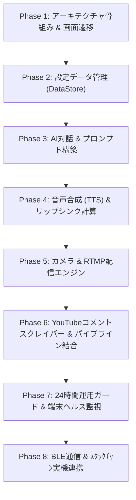

# 実装フェーズガイド

## 💡 実装進め方の方針

AI に実装を依頼する際、一括でコードを生成させると依存関係の崩れやデバッグ困難が生じやすくなります。そのため、**「1フェーズごとに必ずビルド・動作確認（画面表示または単体テスト）が成功すること」** を条件とした **8つの段階的フェーズ** に分けて実装を進めます。

### 3つの開発原則

1. **Fake/Mock アダプターの活用（ｽﾀｯｸﾁｬﾝ後回し）**
   - ｽﾀｯｸﾁｬﾝ（M5Stack）本体やBLE通信が未準備でも開発を止めないよう、最初はログ出力や画面上のダミーアニメーションを行う **`FakeStackChanAdapter`** を使用します。BLE制御は最終フェーズに回します。
2. **ドメイン層の単体テスト (Unit Test) 先行**
   - リップシンク解析やプロンプト生成などの核となるビジネスロジックは、Android に依存しない純粋 Kotlin のドメイン層として先に実装し、JUnit で単体テストを通してから画面やサービスに繋ぎます。
3. **フェーズごとの動く成果物の確認**
   - 各フェーズ完了時に「画面遷移ができる」「設定が保存できる」「カメラが映る」などの目に見える動作確認を行います。

---

## 🗺️ 全8フェーズの全体像



---

## 📋 各フェーズの詳細仕様

### Phase 1: アーキテクチャ骨組み & 画面遷移スキャフォールディング

- **目的**: プロジェクト全体のDDDパッケージ構造、Single Activity ＋ Navigation、ダミーUIの構築。
- **実装内容**:
  - `com.pandapan.stackcast` 配下の 4層パッケージ構造 (`presentation`, `application`, `domain`, `infrastructure`) の作成。
  - `MainActivity` (`activity_main.xml`), `NavHostFragment` (`nav_graph.xml`) のセットアップ。
  - 4つの Fragment (`Dashboard`, `Settings`, `Streaming`, `Summary`) とそれぞれの XML レイアウトおよび ViewBinding 設定。
  - ボタンタップによる相互画面遷移の疎通確認。
- **完了条件**: アプリを起動し、ダッシュボードから各画面へ遷移・戻りが正しく動作すること。

---

## 📝 AI指示用プロンプト例

### Phase 1 実装プロンプト例

AI (Copilot / Cursor / Subagent) に Phase 1 の実装を依頼する際は、以下のテキストをコピー＆ペーストしてご利用ください。

```markdown
# Phase 1 実装依頼: アーキテクチャ骨組み & 画面遷移スキャフォールディング

## 概要
`StackCast` プロジェクトの Phase 1 として、DDD（ドメイン駆動設計）に基づくパッケージ構造の作成、Single Activity + Fragment Navigation のセットアップ、および全4画面のダミーUIと画面遷移ロジックを実装してください。

## 前提条件・制約事項
- **UIフレームワーク**: Jetpack Compose は**使用不可**。Classic Android View System (Single Activity + Fragment + XML Layouts + ViewBinding) を使用すること。
- **パッケージ名**: `com.pandapan.stackcast`
- **コメント規約**: 作成・編集する全クラス・関数・プロパティに KDoc (`/** ... */`) を付与し、**すべてのコメントは日本語で記載**すること。

## 作業手順・指定ファイル

### 1. DDDパッケージ構造の作成
以下のパッケージディレクトリ構造を作成してください：
- `com.pandapan.stackcast.presentation.dashboard`
- `com.pandapan.stackcast.presentation.settings`
- `com.pandapan.stackcast.presentation.streaming`
- `com.pandapan.stackcast.presentation.summary`
- `com.pandapan.stackcast.application`
- `com.pandapan.stackcast.domain.model`
- `com.pandapan.stackcast.domain.ports`
- `com.pandapan.stackcast.infrastructure`

### 2. レイアウトXMLおよび ViewBinding の設定
以下のレイアウトを作成し、`ViewBinding` が有効になるよう構成してください：
- `res/layout/activity_main.xml`: `FragmentContainerView` (`@+id/nav_host_fragment`) を配置
- `res/layout/fragment_dashboard.xml`: タイトル、配信開始ボタン (`btn_start_stream`)、設定ボタン (`btn_settings`)
- `res/layout/fragment_settings.xml`: タイトル、戻るボタン (`btn_back`)
- `res/layout/fragment_streaming.xml`: タイトル、カメラプレビュー枠、配信終了ボタン (`btn_stop_stream`)
- `res/layout/fragment_summary.xml`: タイトル、ダッシュボードへ戻るボタン (`btn_back_to_dashboard`)

### 3. Navigation Graph の定義
`res/navigation/nav_graph.xml` を作成し、`DashboardFragment` をスタート地点として以下の画面遷移アクションを定義してください：
- `action_dashboard_to_settings`: Dashboard -> Settings
- `action_dashboard_to_streaming`: Dashboard -> Streaming
- `action_streaming_to_summary`: Streaming -> Summary
- `action_summary_to_dashboard`: Summary -> Dashboard (PopUpTo Dashboard)

### 4. Activity & Fragment クラスの実装
- `MainActivity.kt`: `activity_main.xml` をセットアップし、スリープ防止 (`FLAG_KEEP_SCREEN_ON`) を設定。
- `DashboardFragment.kt`: ボタンタップで `SettingsFragment` または `StreamingFragment` へ遷移。
- `SettingsFragment.kt`: ボタンタップまたはシステムバックで `DashboardFragment` へ戻る。
- `StreamingFragment.kt`: ボタンタップで `SummaryFragment` へ遷移。
- `SummaryFragment.kt`: ボタンタップで `DashboardFragment` へ戻る。

## 完了確認
- プロジェクトがビルドエラーなしでコンパイルできること。
- アプリを起動すると直接ダッシュボード画面が表示され、各ボタンタップで相互に画面遷移できること。
```

---

### Phase 2: 設定データ管理 (DataStore & Repository)

- **目的**: 配信設定、AI設定、BLE設定の永続化と設定画面の完成。
- **実装内容**:
  - ドメイン層: 値オブジェクト (`RtmpConfig`, `PersonaPrompt`, `BleConfig`) と `SettingsRepositoryPort` インターフェース。
  - インフラ層: Jetpack DataStore (Preferences) による `DataStoreSettingsRepository` の実装。
  - プレゼンテーション層: `SettingsViewModel` と `SettingsFragment` (XMLフォーム) の双方向バインディング。
  - 単体テスト: DataStore への設定値保存・読み込みのテスト。
- **完了条件**: 設定画面で入力した値（RTMP URLやプロンプト）がアプリ再起動後も保持されること。

---

### Phase 3: AI対話ロジック & LLM推論エンジン

- **目的**: コメントに対する AI 応答テキスト生成パイプラインの構築。
- **実装内容**:
  - ドメイン層: エンティティ (`LiveComment`, `AiResponse`), ドメインサービス (`PersonaPromptBuilder`), `LlmInferencePort` インターフェース。
  - 単体テスト: `PersonaPromptBuilder` の各種キャラクター設定・語尾付与のテスト。
  - インフラ層: `LlmInferenceEngine`（MediaPipe GenAI / OpenAI API モック・実機実装）。
  - ユースケース層: `GenerateAiResponseUseCase` の作成。
- **完了条件**: 擬似コメント文字列を渡すと、設定したペルソナプロンプトに従ったAI返答テキストが取得できること。

---

### Phase 4: 音声合成 (TTS) & リップシンク波形解析

- **目的**: 返答テキストからの音声生成と、音量エンベロープによる口パク・首振りパケットの算出。
- **実装内容**:
  - ドメイン層: 値オブジェクト (`LipOpening`, `ServoAngle`), エンティティ (`LipSyncMotion`), ドメインサービス (`LipSyncCalculator`), `TtsPort` インターフェース。
  - 単体テスト: PCM 音声波形（バイト配列）から正しい口の開度 (0.0〜1.0) と角度が算出できるかのテスト。
  - インフラ層: `AndroidTtsEngine`（Android TextToSpeech API）。
  - ユースケース層: `SynthesizeVoiceAndLipSyncUseCase` の作成。
- **完了条件**: テキストを入力すると Android から音声が再生され、ログまたはUI上に口パク開度データの時系列が正しく生成されること。

---

### Phase 5: カメラプレビュー & RTMP 配信エンジン

- **目的**: スマホカメラの全画面プレビュー表示と RTMP 配信エンジンの単体動作確認。
- **実装内容**:
  - ドメイン層: エンティティ (`StreamSession`), `RtmpStreamerPort` インターフェース。
  - インフラ層: RootEncoder ライブラリを用いた `RtmpEncoderEngine` および `StreamingForegroundService` の骨組み作成。
  - プレゼンテーション層: `StreamingFragment` (`SurfaceView`/`OpenGlView`) でのカメラプレビュー表示と、配信開始/停止ボタンの実装。
- **完了条件**: `StreamingFragment` でカメラ映像が映り、「配信開始」を押すと YouTube Live (テスト配信) へ映像が届くこと。

---

### Phase 6: YouTubeコメントスクレイパー & パイプライン統合

- **目的**: チャット取得から LLM 応答・TTS 再生・RTMP 音声ミキシングまでの一連のループの結合。
- **実装内容**:
  - インフラ層: OkHttp による `YouTubeChatScraperEngine` (Innertube ポーリング)。
  - ユースケース層: `ProcessCommentAndRespondUseCase`（コメント取得 $\rightarrow$ LLM推論 $\rightarrow$ TTS合成 $\rightarrow$ RTMP音声ミキサー供給 $\rightarrow$ `FakeStackChanAdapter` へモーション送信）。
  - プレゼンテーション層: `StreamingFragment` 上への統合ステータス（ビットレート、最新発話テキスト、応答ステータス）のオーバーレイ表示。
- **完了条件**: YouTube Live 上で打ったコメントをアプリが自動検知し、AI音声で返答しながら配信画面上にステータスがオーバーレイ表示されること。

---

### Phase 7: 24時間運用ガード & 端末ヘルス監視

- **目的**: 長時間連続運用時のサーマルスロットリング対策、スリープ防止、自動再接続の実装。
- **実装内容**:
  - ドメイン層: 値オブジェクト (`DeviceHealthStatus`), `DeviceHealthPort` インターフェース。
  - インフラ層: `AndroidDeviceHealthMonitor` (バッテリー温度、CPU、ネットワーク状態の BroadcastReceiver 監視)。
  - ユースケース層: `MonitorDeviceHealthUseCase`（高熱時にビットレートを自動降下、無音待機時にサーボ離脱指示）。
  - プレゼンテーション層: 配信中画面への高温警告バッジ表示。
- **完了条件**: 端末の温度変化やネットワーク切断イベントに対して、警告表示や自動低ビットレート化・再接続が動作すること。

---

### Phase 8: BLE 通信 & ｽﾀｯｸﾁｬﾝ実機連携 (本体準備完了後)

- **目的**: ｽﾀｯｸﾁｬﾝ（M5Stack）との Bluetooth 接続およびリアルタイムモーション送信の完成。
- **実装内容**:
  - ドメイン層: `StackChanPort` インターフェース。
  - インフラ層: Android `BluetoothGatt` を使用した `BleController` の実機実装（`FakeStackChanAdapter` から差し替え）。
  - プレゼンテーション層: `SettingsFragment` での BLE デバイススキャン・ペアリングUIの実装。
  - パケット送出: リップシンクパケット (`LipSyncMotion`) のバイナリシリアライズと低遅延送信、省電力トルクオフコマンドの送信。
- **完了条件**: 実機のｽﾀｯｸﾁｬﾝと BLE ペアリングでき、AI の発話に合わせてｽﾀｯｸﾁｬﾝが口パク・首振り運動を行うこと。
